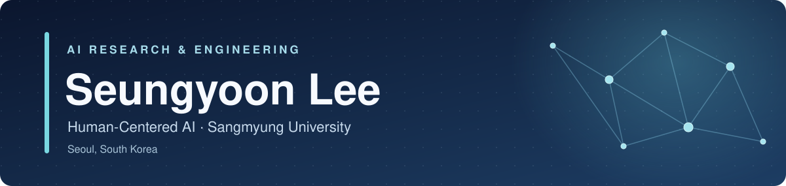

  

  
  

## Hello, I'm Seungyoon 👋

I'm an undergraduate student studying Human-Centered AI at Sangmyung University in Seoul. I'm interested in how we can build AI systems that are not only capable, but also reliable and measurable.

My work spans LLM evaluation, retrieval-augmented generation, reinforcement learning, and healthcare AI.

### Research Interests

  
  
  
  
  
  

---

## Featured Projects

<table>
  <tr>
    <td width="50%" valign="top">
      <h3>01 · <a href="https://github.com/orgs/team-TURINI/repositories">Turini</a></h3>
      <strong>LLM SYSTEMS · AI EVALUATION</strong>
      
Hybrid RAG pipeline for financial education, combining dense and sparse retrieval, reranking, multi-turn retrieval, and evaluation.

       
    </td>
    <td width="50%" valign="top">
      <h3>02 · <a href="https://github.com/maxx0214/mesa-sleep-dataset-python-actigraphy-epworth">MESA Sleep Variability</a></h3>
      <strong>HEALTHCARE AI · RESEARCH</strong>
      
Research on intra-individual sleep variability and daytime sleepiness using wrist actigraphy and the Epworth Sleepiness Scale.

       
    </td>
  </tr>
  <tr>
    <td width="50%" valign="top">
      <h3>03 · <a href="https://github.com/maxx0214/Unity-adversarial-PPO-PenaltyRL">Penalty Shootout RL</a></h3>
      <strong>REINFORCEMENT LEARNING</strong>
      
A competitive multi-agent penalty shootout environment using adversarial PPO and self-play in Unity.

       
    </td>
    <td width="50%" valign="top">
      <h3>Explore more</h3>
      <strong>ENGINEERING · EXPERIMENTS</strong>
      
Additional projects in LLM evaluation, inference benchmarking, and biomedical machine learning.

      <a href="https://github.com/maxx0214?tab=repositories">All repositories →</a>
    </td>
  </tr>
</table>

## Open Source

[**Ragas**](https://github.com/vibrantlabsai/ragas) — Submitted a pull request to the open-source LLM evaluation framework (PR under review).

---

## Tech Stack

**AI & Machine Learning**

  
  
  
  
  
  

**Engineering & Infrastructure**

  
  
  

## GitHub Activity

  

---

  <a href="https://maxx0214.github.io/"><strong>Visit my portfolio ↗</strong></a>

